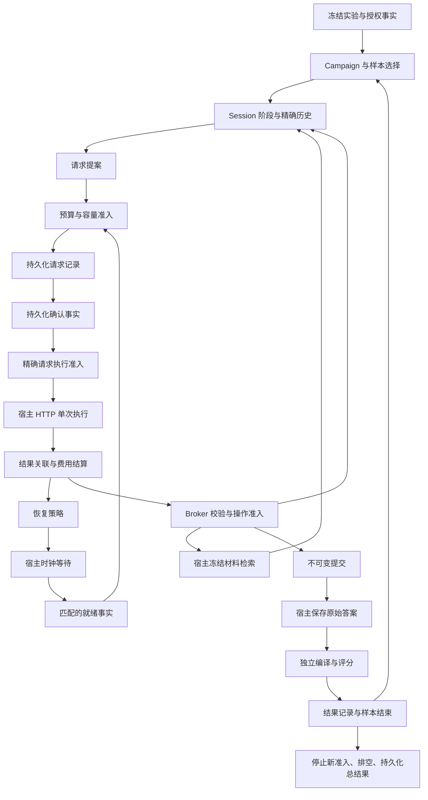

# B121 Graph 主导评测：架构核对与迁移提案

2026-09-18。归属：现有 graphrefly:B121 审查记录。状态：**设计提案，尚未成为架构锁，尚未实施**。
用户批准先核对架构。本轮只读执行代码并整理本记录；没有 provider 调用、预算变更、运行结果重写或新增 D#/工作记录。
本文的节点名、数据字段和文件布局均为提案，不能当成已经导出的 library API。

## 1. 结论与范围

当前 B121 harness **不是 Graph 主导**。Graph-only 描述参与者使用的材料／API 条件，并不表示调度器本身由 Graph 驱动。
`api-runner.mjs` 的循环决定下一请求和阶段，`api-transport.mjs` 的循环决定重试及预留，`candidate-campaign.mjs` 的循环决定样本推进。
最新 `prepare_submit` 修复有局部契约和测试，但依然由 `entrySubmitOnly` 变量执行阶段切换，不能当作架构改造证据。

建议：**一个 campaign 的控制依赖由一个有界 Graph 组合承担；HTTP、文件、时钟、编译进程由专职宿主 adapter 执行；独立评分器核验原始证据。**
不能仅将 `runSession()` 包进一个 Graph 节点，也不能保留另一套外层循环决定下一阶段。
Graph 主导不要求把每个 JSON 字段拆成节点：节点按独立决策职责划分，职责内的纯计算、循环和显式有界节点状态都是合理实现。

本提案覆盖当前 entry campaign，以及共享的 provider qualification／预算／工具／结果持久化；judgment A/B 模式要有单独的阶段分支与隔离测试。
首个离线切片可只迁移 entry，但那时只能称“entry 路径 Graph 主导”；未迁移的 judgment 路径不能一起宣称完成。
此处 Graph 指 GraphReFly 运行时编排，与参与者用于检索源码的 codegraph/MCP 是两个不同问题。

## 2. 已核实的当前控制关系

源码根目录：`~/src/graphrefly/scripts/b121-comparison/`。行号对应本次审查快照，摘要见 [source snapshot](graph-led-architecture-sources.json)。

| 关注点 | 当前实际决策点 | 判断 |
|---|---|---|
| 会话阶段、历史、输入／输出／操作限额 | `api-runner.mjs:158` 的局部状态、`:283` 的主循环 | 宿主控制；不是声明依赖 |
| 主动提交阶段 | `api-runner.mjs:481` 改写 `entrySubmitOnly` | 通用局部修复，但架构归属仍未解决 |
| 比较题 A/B 隔离 | `session.mjs` 的 `createSession` 闭包；entry 不使用它 | controller 这个名称不等于 Graph |
| 每次尝试的预留、HTTP 重试、等待 | `api-transport.mjs:279` 起的内部循环 | transport 兼任工作流和费用权威 |
| qualification、样本顺序、停止 | `candidate-campaign.mjs:325` 起 | 外层命令式调度 |
| 原始答案、冻结编译与评审 | `candidate-entry.mjs`、`compiler-process.mjs` | 值得保留的独立验证边界 |
| CSP11 复用 | `api-transport.mjs:3–11` | 已复用恢复分类和 HTTP 传输，没有复用 Graph 控制拓扑 |

因此不能简单说“所有补丁都随便写”：已有修复确实针对可重现缺陷。但之前的验证集中在局部行为，没有证明控制权符合 Graph 主导目标。
也没有找到足够依据，把 B121 现状直接定性为违反一条已生效的“B121 harness 必须 Graph-native”专门规则。
原 B121 关注的是被测 Graph 消费者与独立根层证据；将 harness 本身 Graph 化是本次需要明确的架构选择。

## 3. 规则、历史与所有权

### 当前规则核对

通过 `authority/model.mjs` 与 federation 生成的当前协议投影，相关已激活规则是 `R-graph-domain@1`：Graph 内同步传播，异步计算结果回到所属域。
`R-sync-core@1`、`R-dispatch-all@1`、`R-no-raw-async@1`、`R-ctx-up@1`、`R-msg-closed-set@1`、`R-fn-contract@1` 的原始行没有 `activated_by`，不在该当前投影中。
这是既有规范激活／表述缺口，本审查不擅自激活它们，也不引用为“当前投影已生效条款”。仓库 AGENTS 的 sync-core、dispatcher、声明拓扑与封闭消息集要求仍约束本次设计。
本提案仅组合现有能力：业务阶段、attempt identity 和预算均是普通 DATA；不添加协议消息、tier、全局 wave id，也不改 dispatcher／conformance。

### CSP11 相关修订链

- `graphrefly-ts:D151`：精确业务 occurrence、显式依赖、不能用定时器隔开业务事件或用 `partial:true`／手发 `RESOLVED` 修补组合。
- `graphrefly-ts:D153` **部分修订 D151**：公共 ToolProviderAdapterBinding 是同步契约，不能误当异步 driver；HTTP leaf 只在兼容处复用，复合异步动作使用分离的私有 adapter。
- `graphrefly-ts:D154`，随后 `D158`：Graph 中的预算／恢复与路由单一来源；D158 修正固定总时长与合法冷却相互冲突的问题。
- `graphrefly-ts:D157`，随后 `D159`：预承诺实验范围与独立执行授权；这套六臂、五重复、memory efficacy 的停止规则不属于 B121，不能照搬。
- `graphrefly:D789` 是真实 memory solution 的 exact-use 生命周期修订，不是通用 eval 调度器授权。

这些是可借鉴的架构证据，不能把 CSP11 的 package-local lock 自动扩张为整个 GraphReFly 的新规范。

### 建议所有权

- root `graphrefly`：评测问题、冻结任务／材料／预算政策、样本表、独立评分及总结果。继续挂在 B121 的现有证据入口。
- `graphrefly-ts`：依赖实际 TS Graph 的私有评测组合、adapter 接线和拓扑验收；建议置于 `packages/ts/evals/b121/`，路径本身尚未落地。
- root 启动器只加载冻结输入、核对实现摘要、连接机械边界并等待结果，不能另行推进样本／重试／阶段。
- orchestrator runtime 的版本单独冻结；被测 library／编译环境另行冻结。测 Python/Rust 不要求以它们重写控制器，也不据此宣称跨语言 conformance。
- 不创建公共通用 eval framework、泛化 effect primitive 或 provider registry。若发现真实 library 缺陷，单独提出可复现问题并按所属层修复。

## 4. 建议的控制拓扑

图是设计图，不是从现有运行生成的 `graph.describe()`。实际实现必须输出真实 describe 和对应观察证据。
时钟返回只表示某个等待已经到期；恢复策略和预算准入仍决定是否允许新请求。图中的持久化和 I/O 节点代表明确的请求／确认边界。

| 决策职责（Graph） | 输入与必须具备的依赖 | 宿主允许做的事 |
|---|---|---|
| Campaign | manifest、固定样本顺序、qualification 结果、样本 terminal；未运行项也保留 | 读取并验证冻结文件，提供内容与摘要 |
| Session | 独立 session/task、阶段修订、完整历史摘要、精确工具结果 | 保管只读文本／字节，按已准入引用读取；不能补提示或压缩历史 |
| Request proposal | session revision、当前请求配置、历史、输入估计、输出分配 | 执行估计器，返回绑定请求摘要的估计；估计不是费用上界证明 |
| Budget admission | 已知费用＋未决预留＋在途预留、授权、所有独立限额、请求与价格版本 | 最后一道 capability/限额核对只能拒绝，不另行准入或提高限额 |
| Retry | 精确失败事实、冻结的分类／次数／延迟、剩余预算与期限 | 单次 HTTP 和计时；不得在 transport 内自行重试 |
| Tool admission | 精确 response/tool-call、当前阶段、allowlist、批次和操作数 | 搜索／读取冻结文件；恢复性错误返回事实，不决定接着读哪里 |
| Submission | 当前阶段、一次性 submit、原始内容与摘要 | 写原始答案；不修代码、不增加模型回合 |
| Assessment lifecycle | 提交持久化确认、冻结 compiler/rubric、检查请求与结果引用 | 独立编译子进程、可信评审输入、评分证据保存 |
| Terminal | 所有预定样本状态、已准入动作排空、必要证据持久化 | abort/drain、关闭句柄、原子保存；不得将进程退出0解释为通过 |

**身份与关联：** 每条动作至少绑定 campaign/manifest、session/task、阶段修订、request digest、attempt ordinal 和 effect id；结果引用原准入。
业务身份不是 wave 身份。按 key 精确关联，不以“各依赖最新值”拼接不同请求。
同一身份同一内容重放幂等，身份相同但摘要冲突拒绝并记录；迟到的旧结果不能推进新阶段。迟到费用证据仍可结算它原来的未决项，不得丢掉以美化费用。
有界 pending／receipt 状态由 Graph 节点持有；adapter 仅持有执行中句柄、已执行身份和清理状态，不能另藏阶段与下一样本。

**持久化与崩溃：** Graph 提案先取得写前记录的精确确认，再放行一次 HTTP。写入失败不发请求。
崩溃重启只能恢复原冻结版本的记录并核对，不能把记录过的请求盲目再发；记录后、响应保存前的窗口无法证明 exactly-once，保留未知预留和中断状态。
Graph 不能把分布式 HTTP 变成 exactly-once。必要证据失败时结果不具备完整有效性；可选诊断失败不能阻塞费用结算／清理或制造重试。

**独立裁判：** Graph 可以控制“何时安排编译／收集判定”，但通过与否仍可从原始答案、冻结 compiler/rubric 和独立评审记录重算。
审查结果以 `submissionDigest + verifierDigest + criterion` 关联；评分器不依赖 Graph 内部缓存的 passed 标志，不接收被测 snippet 自报成功。
运行完成、提交有效、评分通过是不同字段；harness/模型/网络失败同样保留，不混成 library 错误，也不删分母。

## 5. CSP11 复用矩阵

参考目录：`~/src/graphrefly-ts/packages/ts/evals/graph-native-rerun-avoidance/`。

| 已有实现 | 建议 | 限制 |
|---|---|---|
| `openrouter-transport.mjs`、`openrouter-recovery.mjs` | 继续复用单次传输、错误解析和纯恢复计算 | retry 决策调用在 Graph 节点；不能保留 B121 transport 的隐藏恢复循环 |
| `focused-async-adapters.ts` | 复用精确 admission/outcome 校验、去重与 drain 的机械逻辑 | 当前 exports 绑定 CSP11 effect 类型，不是 B121 可直接调用的通用公共API；先验证私有抽取是否确实相同 |
| `provider-qualification.ts:379` | 小型状态→预算→准入→terminal 的组合参考 | qualification 次数、任务与价格取 B121 冻结输入，不继承 CSP11 常量 |
| `eval-topology.ts:7161` 的准入节点、`:7384` 的工具准入 | 复用职责划分、守恒与关联验收思路 | 不复制六臂 memory/work-item 领域状态、分数门槛或整个大图 |
| `root-eval-live.ts:2487` 的分离 adapter | 参考 HTTP/tool/time/billing 边界 | 不把同步公共 runtime 强行扩展成 Promise runner（D153） |
| `eval-topology-contract.ts` 和拓扑测试 | 复用真实 describe、必需边、变异检测方法 | 仅对 describe JSON 做删除检查还不够；B121 要验证实际执行路径不能绕过边 |
| B121 原有 source broker、compiler subprocess、manifest 与 journal | 保留纯功能及独立核验 | 拆出其中的调度权，不能整段包进 Graph 冒充迁移 |

节点数多少不作为目标；CSP11 的完整性来自可验证的依赖与执行关系，而不是把它的节点数量搬过来。

## 6. 三条必须打通的具体轨迹

### A. 1,243 输出限额下主动进入提交阶段

1. 旧开发事件暴露：参与者直接写大答案，1243 输出耗尽后工具参数为空。这仍是历史失败，不能改判。
2. 迁移后的冻结策略若保留 `prepare_submit`：模型提出无答案的独立操作，Graph 先验证批次和当前阶段，再计一次操作并转换 session revision。
3. 下一请求由新阶段及剩余预算共同导出，最多使用原预留4096；输入、总输出、次数和时间仍可能使请求被拒绝。
4. adapter 只发收到的请求。直接 submit 仍受当前请求限额；重复 transition、混合 batch、提交后检索依原冻结规则终止，不给修答案回合。

### B. Socket 断开与重试

1. 请求 N 先记录并预留；HTTP 无响应头，返回精确 attempt 的传输失败事实，不能记成429。
2. Graph 保留 N 的未知费用，按冻结策略决定是否准许一次 availability 等待；宿主只等待规定时长。
3. 只有匹配的 readiness、当前会话状态及足够新预留共同成立，才准入 N+1。旧等待重复回送不会多发请求。
4. N+1 成功只结算 N+1；N 的404查询、无ID或不精确的累计用量不能释放其预留。取消停止新准入并排空已有动作。

### C. 错误类型导入与评分

1. 提交从 `@graphrefly/ts/core` 导入不存在类型的原始答案，先不可变保存。
2. 独立冻结编译器返回 TS2305；Graph 记录该样本失败并按冻结样本规则继续或结束。
3. 不用 Codex 改成正确 import 后复测该样本。文档改善成为后续 library/material 版本，旧失败仍保留。

## 7. 备选与建议

| 方案 | 收益 | 代价／判断 |
|---|---|---|
| 保留命令式 harness，仅改称谓 | 最少改动，也可做接口易用性测试 | 不能满足本次 Graph 主导目标 |
| **有界 B121 Graph 组合＋专职 adapter** | 关键控制依赖可观察、可变异验收；保留独立裁判 | 推荐；需迁移状态和建立离线等价证据 |
| 全量复制 CSP11 或抽象公共 eval framework | 表面上“统一” | 引入与 B121 无关的 memory 实验政策及公共API成本，当前不采用 |

提议的架构措辞：
> B121 的每个已迁移 campaign 用一个 Graph 作为阶段、预算预留、重试／工具准入和业务终止的唯一决策源。宿主仅执行精确准入的外部动作并回送事实；独立验证器根据冻结材料与原始产物核验成绩。运行控制、被测 library 和评分三者版本分别绑定。控制策略迁移不得追改历史结果或放宽冻结实验条件。

这是供审批的具体提案，不因文档写入而自动生效。架构选择按 root 跨项目范围准入；TS 实现细节仍在 package owner，不复制决策正文。

## 8. 实施顺序与离线验收（待授权落地）

1. 固定当前源码快照和纯策略输入；区分历史 v11 与尚未 live 的 submission-transition 版本。迁移不顺带改任务、模型、预算或停止标准。
2. 用合成响应和已曝光开发轨迹建立离线对照：相同输入得到相同请求／阶段／次数／提交／失败分类，设计指定的新增诊断除外。
3. 迁移 entry 的 session、准入、结算、重试与工具；删除对应外层调度权。再接 campaign qualification／样本表、持久化、独立编译与评审。
4. 将 judgment A/B 的当前边界作为独立分支迁移并验证；未完成前明确覆盖范围，不能藏成命令式 fallback。
5. 完成下面的架构、故障和证据验收后，才准备新实现manifest与新轮评测。开发回放不当新模型成绩；本轮不发起付费验证。

关键验收：

- **真实控制关系**：保存原始 `graph.describe()` 和带因果身份的观察；禁止人工从日志重建图充当运行拓扑。移除预算／阶段／持久化确认依赖，实际 adapter 计数必须为0，或拓扑在启动前被拒绝。
- **非装饰包装**：审查无 `runSession()` 黑盒大节点；host 无 `entrySubmitOnly`、下一样本、retry ordinal 等独立领域权威。节点内职责相关的 reducer/循环允许存在。
- **精确关联**：跨任务、跨阶段、错误摘要、冲突重放不能授权执行；同一事实的批量／分批／乱序独立交付不串会话；不使用 domain-ordering timer 或 `partial:true` 修补。
- **预算守恒**：已知费用＋未决＋在途预留不超过冻结可用上限；每次尝试单独占用，重复结算不减两次，404不释放未知预留；进程外cap只增加拒绝保护，不授予支出。
- **独立限额**：1M context、累计input、output、operations、turns、time、money 分开测试；新阶段不增加总额度；迁移不偷偷采用 CSP11 的不同期限策略。
- **失败矩阵**：429、5xx、无HTTP socket、超时、取消、响应JSON/工具截断、检索可恢复错误、编译崩溃/超时、写前记录失败、结果持久化失败；每项有明确归因且保留分母。
- **崩溃窗口**：写前记录前不发请求；写前记录后／响应保存前崩溃不自动重发；恢复保留 unknown 与单次claim，不把恢复当新样本。
- **结束与清理**：有效失败也能结束；已准入动作排空、必要证据确认后才输出完整 run；可选日志故障不改变动作事实或阻塞关键清理。有限deadline防止无限等待，但不假造业务成功。
- **独立核验**：外部重算 submission／compiler／rubric 摘要与结果；篡改 Graph passed 字段不能改变核验分数。participant 看不到 rubric、其他会话答案或 orchestrator 内部材料。
- **冻结与复用**：TS runtime、root策略、所有抽取helper纳入manifest；修改任一相关源码使旧执行绑定失效。原结果保持不可变。

这些是计划中的验收，不是本轮已通过的测试。当前源码核对能确认命令式控制与 CSP11 的真实 Graph 节点，但不能证明尚未实现的迁移正确。

## 9. 本轮交付与局限

交付：本架构报告、被审查文件摘要、下一轮草案入口链接；无执行代码、library API、规范或权威记录变更。
核验：读取当前源码与修订链，生成相关当前规则投影（resolver errors 为0）；文档链接及源码摘要单独校验。
本轮没有重跑211项 harness 测试，也没有运行 CSP11 测试；此前测试成绩不作为本提案实现通过的证据。未进行独立多agent架构复核。
尚待实施证据决定：现有 focused adapter 的机械内核能否无领域泄漏地私有复用；真实 Graph 组合是否保持所有 B121 冻结策略；规则激活缺口应另行在权威维护工作中处理。
